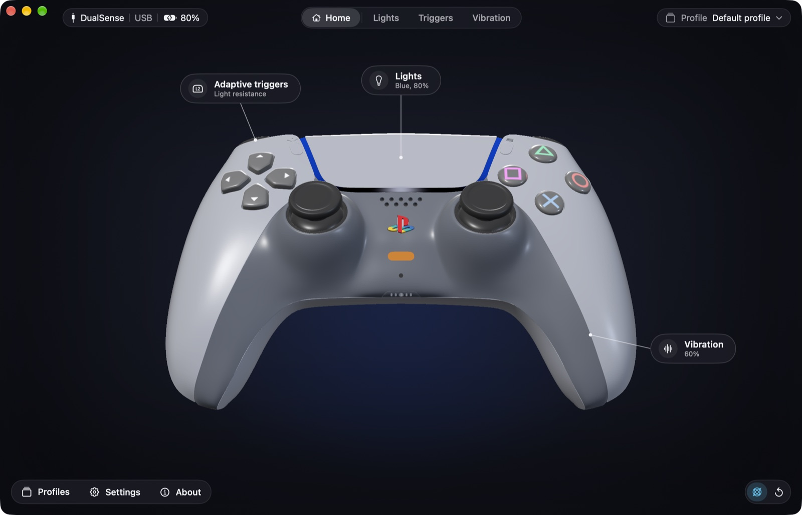

# DS5Mac

A free Mac app for the PlayStation 5 DualSense controller: set the lightbar,
the player LEDs and the adaptive triggers, test the vibration, see every
button and stick live on a 3D model of the controller, and switch settings
by themselves for each game.

**[Download DS5Mac](https://github.com/imellag/DS5Mac/releases/latest)** ·
[Website](https://imellag.github.io/DS5Mac/) ·
[What's new](https://imellag.github.io/DS5Mac/changelog/)

## Requirements

- macOS 15 or later
- A DualSense controller, over USB or Bluetooth

DS5Mac updates itself: it checks once a day and asks before installing.

## Report a bug

Use **Help › Report a Bug…** inside DS5Mac: it opens a report here with the
app, macOS and controller details already filled in. Or
[open an issue](https://github.com/imellag/DS5Mac/issues/new/choose)
directly.

## About this repository

This repository holds the website, the releases and the bug reports. The
app's source code is not public.

## Credits

The 3D model is "Dualsense Blender Project" by
[bluesassassins](https://bluesassassins.gumroad.com/l/ggxgbo), licensed
under [CC BY-SA 4.0](https://creativecommons.org/licenses/by-sa/4.0/), and
adapted for DS5Mac. Updates use [Sparkle](https://sparkle-project.org).

DS5Mac is an independent project. It is not affiliated with, endorsed by,
or sponsored by Sony Interactive Entertainment. "PlayStation", "PS5" and
"DualSense" are trademarks of Sony Interactive Entertainment Inc.
